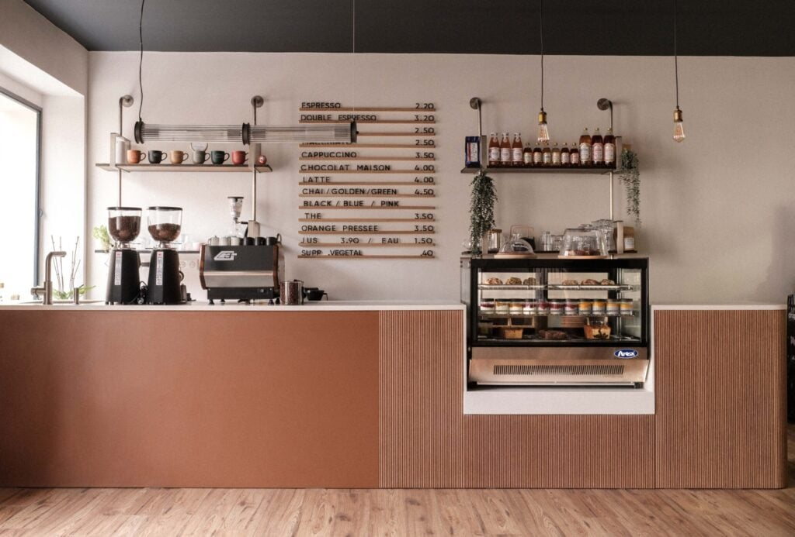
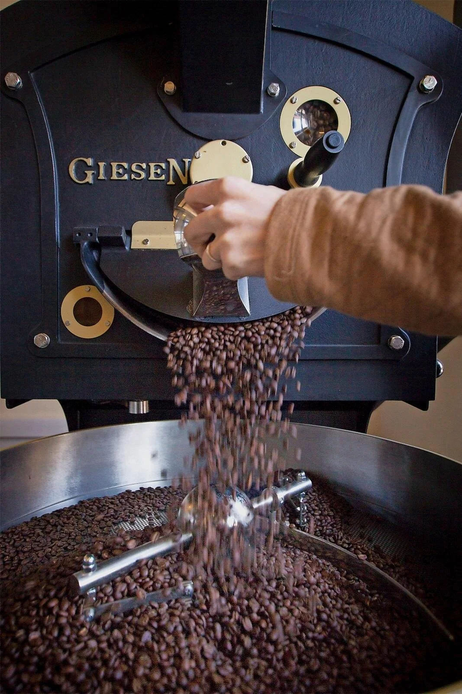
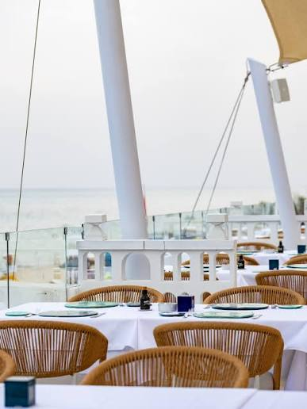

# Real Café — Specialty Coffee Experience

<p align="center">
  
</p>

<p align="center">
  <strong>A refined digital experience for a specialty coffee brand in Tunis.</strong><br />
  A responsive café website with an interactive menu, table reservations, an online coffee shop, and a protected back-office.
</p>

<p align="center">
  <a href="https://grain-et-cendre-dusky.vercel.app/"><strong>Live Demo</strong></a>
  ·
  <a href="https://github.com/WissemAttouf/Real-Cafe"><strong>Source Code</strong></a>
</p>

<p align="center">
  
  
  
  
  
  
</p>

---

## Overview

**Real Café** is a specialty-coffee website concept designed around editorial visuals, a carefully presented coffee menu, and practical customer journeys. Visitors can discover the café, explore coffee origins and brewing information, make a reservation, and browse products through the shop experience.

The project combines a static-first front end with Vercel serverless API routes for data-backed features. Supabase is used for persistence, Resend for transactional email, and Playwright for browser-level tests.

> **Live application:** [grain-et-cendre-dusky.vercel.app](https://grain-et-cendre-dusky.vercel.app/)

## Visual Preview

The repository includes photography used by the experience:

<p align="center">
  
  
  
</p>
<p align="center">
  
  
</p>

## Key Features

### Customer experience
- **Responsive café website** with dedicated sections for the café story, menu, coffee origins, and reservations.
- **Interactive menu** powered by editable JSON data.
- **Coffee discovery** with roast-of-the-week information and brewing-guide content.
- **Reservation flow** with date-based availability, time-slot selection, form validation, and confirmation feedback.
- **Online shop experience** with product listings, product details, cart, and checkout pages.
- **Multilingual content** with French and Arabic locale files.
- **Progressive Web App assets**, including a web manifest and application icons.
- **Motion and interaction details** such as scroll reveals, parallax effects, animated elements, and a mobile navigation menu.

### Back-office and API
- Protected admin pages for reservation, order, and product management.
- Serverless API routes for availability, reservations, products, orders, and administrative operations.
- Supabase integration for application data.
- Resend integration for reservation and order emails.
- Request validation, a honeypot field, and in-memory rate limiting for reservation requests.
- Security-related HTTP headers and a Content Security Policy configured in `vercel.json`.

### Quality and observability
- Playwright browser tests for key page, menu, localization, and reservation flows.
- Sentry browser integration.
- SEO support files, including `robots.txt` and `sitemap.xml`.

## Technology Stack

| Area | Technologies |
| --- | --- |
| Front end | HTML5, CSS3, modern JavaScript (ES modules) |
| Serverless API | Vercel Functions, Node.js |
| Database | Supabase |
| Email | Resend |
| Monitoring | Sentry |
| Browser testing | Playwright |
| Hosting | Vercel |

## Architecture

```text
Real-Cafe/
├── index.html                 # Main landing page
├── boutique.html              # Shop page
├── checkout.html              # Checkout experience
├── styles.css                 # Main design system and styles
├── data/
│   ├── menu.json              # Menu content
│   ├── roast.json             # Featured roast information
│   └── carnets.json           # Coffee journal content
├── js/
│   ├── main.js                # Front-end entry point
│   ├── core/                  # Shared UI and status utilities
│   ├── features/              # Menu, cart, booking, shop, localization…
│   └── utils/                 # Shared helpers
├── api/
│   ├── reservation.js         # Reservation endpoint
│   ├── availability.js        # Available time slots
│   ├── products.js            # Public product catalog
│   ├── order.js               # Order submission
│   └── admin/                 # Protected management endpoints
├── admin/                     # Back-office pages and scripts
├── lib/                       # Validation, storage, email, rate limiting
├── locales/                   # French and Arabic translations
├── assets/                    # Images, fonts, video, and icons
├── tests/                     # Playwright tests
├── playwright.config.js
├── package.json
└── vercel.json                # Hosting and security configuration
```

## Run Locally

### Prerequisites

- Node.js **20 or later**
- npm
- A Vercel account / Vercel CLI for running the serverless routes locally
- Supabase credentials for database-backed functionality
- Resend credentials if you want to test email delivery

### 1. Clone the repository

```bash
git clone https://github.com/WissemAttouf/Real-Cafe.git
cd Real-Cafe
```

### 2. Install dependencies

```bash
npm install
npm install --global vercel
```

### 3. Configure environment variables

Create a local `.env.local` file in the project root. Do not commit it.

```dotenv
SUPABASE_URL=https://YOUR_PROJECT.supabase.co
SUPABASE_SERVICE_ROLE_KEY=your_supabase_service_role_key
ADMIN_PASSWORD=replace_with_a_strong_unique_password
RESEND_API_KEY=re_your_api_key
RESEND_FROM=onboarding@resend.dev
RESEND_TO=your_verified_recipient@example.com
SITE_URL=http://localhost:3000
```

**Important**
- Use the Supabase **service-role key only in server-side environment variables**. Never expose it in browser JavaScript or commit it to Git.
- Configure the database tables and columns expected by the API before testing reservations, products, or orders. The current repository does not include a checked-in Supabase schema/migration file.
- Resend may restrict recipients when using its onboarding sender. Use a verified sender/domain for production email delivery.
- Set production values in **Vercel → Project → Settings → Environment Variables**.

### 4. Start the local Vercel environment

```bash
vercel dev
```

Open the local URL displayed by the CLI (usually `http://localhost:3000`).

## Testing

The project uses Playwright. Its configuration starts the application with `vercel dev`.

Run the test suite:

```bash
npm test
```

Open Playwright's HTML report after a run:

```bash
npm run test:report
```

Launch the interactive test runner:

```bash
npm run test:ui
```

The test suite is configured for Chromium. External services and valid environment variables may be needed for tests that exercise API-backed features.

## Deployment

The project is configured for **Vercel** and includes a `vercel.json` file with clean URLs, security headers, cache policies, and rewrites for machine-readable API catalog routes.

1. Import `WissemAttouf/Real-Cafe` into Vercel.
2. Add the required environment variables in the project settings.
3. Configure the required Supabase tables and policies.
4. Deploy and test reservations, email delivery, product data, and admin endpoints in the deployed environment.

Live deployment: [grain-et-cendre-dusky.vercel.app](https://grain-et-cendre-dusky.vercel.app/)

## Content Maintenance

| Content | File |
| --- | --- |
| Café menu | `data/menu.json` |
| Featured roast | `data/roast.json` |
| Coffee journals | `data/carnets.json` |
| French translations | `locales/fr.json` |
| Arabic translations | `locales/ar.json` |
| Security and routing headers | `vercel.json` |

When updating product data, ensure the Supabase records and the shop UI remain consistent.

## Security Notes

- Keep all secrets in environment variables and out of version control.
- The admin API authenticates requests with a bearer token derived from `ADMIN_PASSWORD`; use a strong, unique value.
- Reservation input is validated server-side and protected by a honeypot and in-memory rate limiter.
- In-memory rate limiting is not shared across serverless instances. For higher traffic, replace it with a distributed store such as Redis.
- Review the Content Security Policy whenever introducing new third-party scripts, fonts, images, or APIs.
- Do not treat a successful API response as proof that email delivery or an external service completed; inspect service logs when troubleshooting.

## Roadmap Ideas

- Check in versioned Supabase migrations and documented database setup.
- Add a repeatable CI workflow for linting and browser tests.
- Move rate limiting to a distributed store for production scale.
- Add screenshots of the key customer and admin journeys as the UI evolves.

## Author

**Wissem Attouf**  
Full Stack Developer

- GitHub: [@WissemAttouf](https://github.com/WissemAttouf)
- Project repository: [Real-Cafe](https://github.com/WissemAttouf/Real-Cafe)
- Live demo: [grain-et-cendre-dusky.vercel.app](https://grain-et-cendre-dusky.vercel.app/)

---

<p align="center">
  <sub>Built with care for the specialty coffee experience.</sub>
</p>
